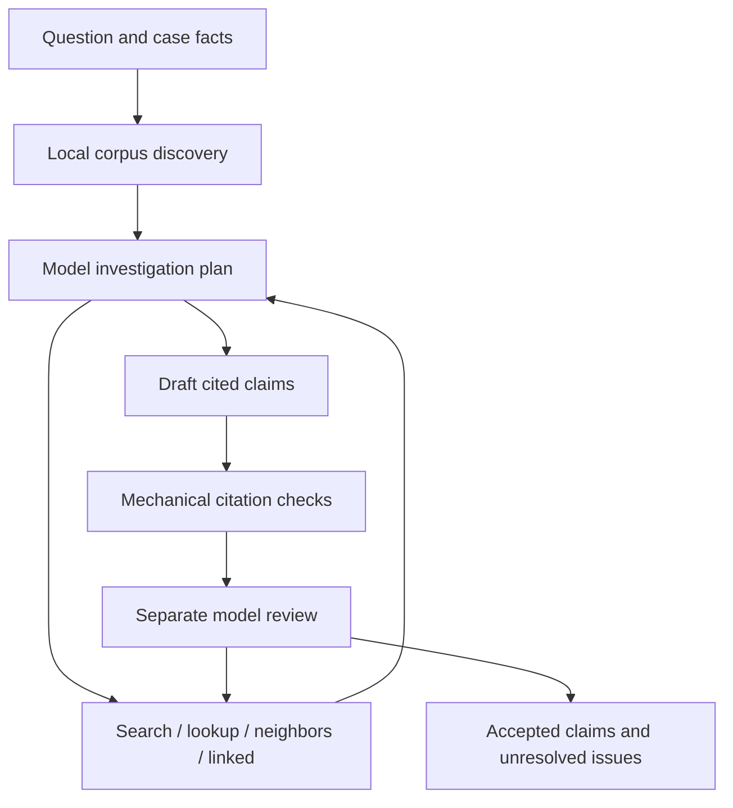

# Regulatory Investigation Agent

**Scientific AI Builder · Project 003 · Track B: Independent Codex-built v1** — a Python agent that investigates EU food-law
questions using five supplied, frozen regulation HTML documents.

Codex designed and implemented the architecture, retrieval, investigation workflow,
tests, debugging, and documentation under human-provided requirements and budget
limits. The user supplied the case, corpus, model selection, evaluation instructions,
credentials, and approvals. The build did not use the previous Regulatory_agent
implementation, Build 1–4 answers, or Gold Standard answers.

## Companion project and shared assessment

This repository is **Track B**, an independent Codex-led implementation. **Track A** is the [human-guided Architecture Learning Lab](https://github.com/hyejeong0617/Regulatory_agent), which experimentally progressed from prompt-only to RAG, tools and an investigation workflow. The code and benchmark answers from Track A were not supplied to this independent build.

Read the [Project 003 architecture and evaluation comparison](https://github.com/hyejeong0617/Regulatory_agent/blob/main/docs/PROJECT003_COMPARISON.md) for the two approaches and their evaluation provenance. Track A has owner-reviewed benchmark summary scores. Codex-built v1 has published execution artifacts; a separate AI-assisted Gold Standard comparison was discussed, but the item-level scoring source has not been verified in these public repositories and **human verification is still pending**. Therefore the execution statuses below must not be read as Correct/Grounded/Complete grades.

## What it does

- Parses and fingerprints legal Articles, Annexes, tables, and linked notes.
- Uses local BM25 search and targeted provision lookup to gather evidence.
- Lets the model choose additional searches, neighboring records, and local links.
- Produces atomic claims with exact source quotations and evidence identifiers.
- Checks citations in code and reviews claims in a separate call to the same model.
- Records missing facts, unsupported claims, coverage gaps, costs, and tool actions.

The corpus contains historical snapshots. This project does not establish current
law or guarantee legal accuracy. Aflatoxin detection alone is not proof of exceedance.

## Quick start: offline, no API key or package installation

Python 3.11 or newer is required. Runtime and tests use the standard library.

```bash
git clone https://github.com/hyejeong0617/regulatory-investigation-agent.git
cd regulatory-investigation-agent
python -m regulatory_agent doctor
python -m regulatory_agent search "dried figs aflatoxin maximum level"
python -m regulatory_agent ask "Which provisions address import documentation for dried figs from Türkiye?"
python -m unittest discover -s tests -v
```

Offline answers are evidence packs, explicitly marked `evidence_only`. They are not
model-generated legal assessments. See [usage](docs/usage.md) for live configuration.

## Architecture



Tool actions are structured JSON selected by the model and executed by Python.
There is no hosted vector database, external legal web search, or paid built-in tool.
See [architecture](docs/architecture.md) and [the core workflow](regulatory_agent/agent.py).

## Frozen v1 evaluation

Model: **gpt-6-luna**. Reasoning effort: **medium**. The offline suite passed **39 tests**.

| Questions | Origin | Result |
|---|---|---|
| Q1–Q4, Q6–Q8, Q10 | Independent post-freeze runs | `partial`, no execution errors |
| Q9 | Post-freeze run | `incomplete`: model response did not complete; not retried |
| Q5 | Previously executed development smoke | `partial`; preserved without rerunning |

`partial` denotes unresolved issues, not an accuracy score. Gold Standard grading
has not been performed. Q5 used the subsequently frozen v1 implementation, model, corpus and matching runtime limits; it was retained from pre-freeze development, not rerun as a held-out post-freeze test. Raw answers and errors are preserved without optimization.

- Nine new evaluation questions: **$0.141455325** estimated API cost.
- Selected Q1–Q10 outputs including Q5: **$0.155075500**.
- Cumulative development/evaluation known usage: **$0.156769550**.
- Including a retained **$0.5295** uncertain transport reservation: **$0.686269550 / $2**.

[Evaluation report](evaluation/v1/EVALUATION_REPORT.md) ·
[Machine-readable summary](evaluation/v1/evaluation_summary.json) ·
[Evaluation protocol](docs/evaluation_protocol.md)

## Repository layout

```text
regulatory_agent/    Frozen v1 runtime code
config/             Disabled example pricing configuration
data/               Five legal HTML snapshots and original benchmark questions
tests/              Offline regression suite
scripts/            Offline validation and explicit paid smoke entry point
docs/               Architecture, usage, protocol, and development history
evaluation/v1/      Freeze metadata and preserved Q1–Q10 results
.github/workflows/  Offline tests only
```

## Reproducibility and publication

The runtime Python files, tests, source HTML, benchmark questions, and raw answer
files are copied unchanged from the evaluated workspace. Publication reorganizes
documentation and adds relative links and offline CI; it does not change the agent.
The historical freeze manifest describes the original workspace, including its
original documentation paths. See [publication provenance](docs/publication.md).

No credentials, virtual environment, or live SQLite budget ledger are tracked.
Do not replace an existing development ledger with an empty one when continuing
the same budget. This clone does not inherit another machine's spending history.

## Limitations

Lexical retrieval may miss relevant provisions. Complex legal tables and external
references can remain unresolved. Source snapshots differ in date. Exact quotations
prove provenance, not entailment; same-model review can share the draft's mistakes.
Question-to-issue labels can produce redundant unresolved-issue messages. The frozen
configuration may exhaust output or execution limits, as recorded for Q9.

## Licensing and attribution

An open-source license for the original code has not yet been selected by the
repository owner. Public availability does not itself grant a software license.
The supplied EU legal documents retain their own provenance and applicable terms;
see [data documentation](data/README.md). [MIT licensing is an option pending owner approval](docs/license_decision.md); the current notice has not been replaced. This is a Codex-built research project,
not an official EU or OpenAI legal advisory service.
